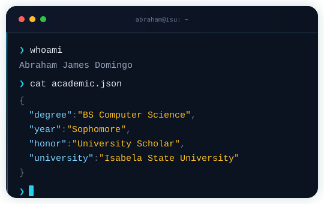

  

 

## `> whoami`

<table>
  <tr>
    <td width="52%" valign="middle">
      
I'm <strong>Abraham James Domingo</strong>, a <strong>Sophomore BS Computer Science student</strong> at <strong>Isabela State University</strong> and a <strong>University Scholar</strong>.

      
I like turning complex problems into clear, logical steps — then writing clean code that brings those steps to life. Right now, I'm focused on building strong foundations in <strong>data structures, algorithms, and software development</strong>, one project at a time.

      <ul>
        <li>🎓 <strong>BS Computer Science</strong> · Sophomore</li>
        <li>🏅 <strong>University Scholar</strong></li>
        <li>🧠 Focused on <strong>DSA &amp; OOP</strong></li>
        <li>🤝 Open to <strong>internships &amp; collaborations</strong></li>
      </ul>
    </td>
    <td width="48%" align="center">
      
    </td>
  </tr>
</table>

## `> tech_stack`

  <picture>
    <source media="(prefers-color-scheme: dark)" srcset="https://skillicons.dev/icons?i=py%2Cjava%2Ccpp%2Chtml%2Ccss%2Cjs%2Cgit%2Cgithub%2Cvscode%2Cmysql%2Cfigma&amp;theme=dark&amp;perline=11" />
    
  </picture>
    
  <strong>Languages</strong> · Python · Java · C++ · JavaScript · HTML · CSS 
  <strong>Tools &amp; Design</strong> · Git · GitHub · VS Code · MySQL · Figma

## `> currently_learning`

  

<table>
  <tr>
    <td width="33%" align="center" valign="top">
      <strong>🧩 Data Structures</strong> 
      Building problem-solving habits through patterns, complexity, and deliberate practice.
    </td>
    <td width="33%" align="center" valign="top">
      <strong>🧱 Object-Oriented Programming</strong> 
      Writing code that is modular, reusable, and easier to reason about.
    </td>
    <td width="33%" align="center" valign="top">
      <strong>🌐 Web Development</strong> 
      Creating responsive interfaces with HTML, CSS, and JavaScript.
    </td>
  </tr>
</table>

## `> education`

<table>
  <tr>
    <td width="78%" valign="middle">
      <h3>🎓 Isabela State University</h3>
      
<strong>Bachelor of Science in Computer Science</strong> 
      Sophomore · <strong>University Scholar</strong>

      
Building a strong foundation in computer science through consistent learning, disciplined practice, and a genuine curiosity for how things work.

    </td>
    <td width="22%" align="center">
      
    </td>
  </tr>
</table>

## `> let's_connect`

  
I'm always open to learning from others, contributing to meaningful projects, and exploring internship opportunities.

  
  
  
    
  <em>“First, solve the problem. Then, write the code.” — John Johnson</em>

## `> contribution_graph`

  <picture>
    <source media="(prefers-color-scheme: dark)" srcset="https://raw.githubusercontent.com/abrahamjamesdomingo/abrahamjamesdomingo/output/github-contribution-grid-snake-dark.svg" />
    <source media="(prefers-color-scheme: light)" srcset="https://raw.githubusercontent.com/abrahamjamesdomingo/abrahamjamesdomingo/output/github-contribution-grid-snake.svg" />
    
  </picture>
  Auto-refreshes every 12 hours as my contributions grow.

 

